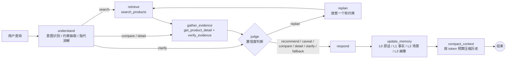

# Evidence-grounded Shopping Agent

一个基于证据做决策的多轮购物 Agent。它把用户的口语化购物需求转成结构化约束，检索候选商品，聚合并校验商品证据，再根据证据的覆盖度、冲突和置信度决定是推荐、对比、追问还是兜底。

> 个人学习项目。商品数据全部为模拟数据（`data/products.json`），链接指向 `example.com`，与任何真实平台无关。

## 解决的问题

| 问题 | 本项目的做法 |
| --- | --- |
| 复杂购物需求难以用关键词表达 | 意图识别 + 约束抽取，把品类、预算、品牌、属性转成结构化条件 |
| 多轮对话中用户约束和候选商品丢失 | 结构化工作状态 + 会话记忆（Redis checkpointer）；约束和展示快照每轮固定注入，不参与上下文压缩 |
| 长对话撑爆上下文 / 固定保留 N 轮丢约束 | 按 token 预算压缩：安全切分（不拆工具调用）、先归档再增量摘要、`recall_context` 按需取回 |
| 一次性需求污染用户画像、画像说不清来源 | L0–L3 分层长期记忆：事实带作用范围、确认次数和原话出处，覆盖而不删除 |
| 玩具数据说明不了效果 | 接入 ShoppingBench 的 250 万商品沙箱和 750 条标注任务，输出官方格式 rollout |
| 证据不足时模型直接给推荐 | 证据层统一校验价格、库存、商家、时效；不可用或低置信度的商品不推荐或带提示推荐 |
| 检索为空时只会重复调用工具 | 重规划：按顺序放宽软约束；硬约束从不自动放宽，没有结果就兜底并给出最接近的选项 |
| 出了 bad case 不知道错在哪 | 每个节点、每次 skill 调用都写 trace，支持回放和错误归因 |
| 改了策略不知道有没有引入新问题 | 回归门禁：分层指标 + 失败阶段分布和基线逐项对比；消融表量化每个模块的贡献 |
| 用户隐私、套话、模型编造 | 记忆按用户隔离并脱敏；套话意图直接拦截；回复里的价格必须和证据层一致 |

## 架构



- **编排**：LangGraph `StateGraph`。每个节点只读写 `AgentState`，由 `harness.guarded()` 统一计时、记录 trace、兜底异常。
- **会话记忆**：LangGraph checkpointer，按 `thread_id` 保存整个状态。配置了 `REDIS_URL` 就用 `RedisSaver`，否则用内存。对话历史超过 token 预算时由 `compact_context` 压缩，详见 [docs/context_compression.md](docs/context_compression.md)。
- **长期记忆**：LangGraph Store，按 `user_id` 分 L0–L3 四层保存。L1 事实只从“本轮约束变化”里抽取，带作用范围（本次会话 / 长期）、确认次数和原话出处；L3 画像由 L1 聚合，新会话第一次出现某个品类时用它预填约束，并告诉用户“沿用了之前的偏好”。详见 [docs/long_term_memory.md](docs/long_term_memory.md)。

## 模块

| 模块 | 职责 |
| --- | --- |
| [`harness.py`](src/shopping_agent/harness.py) | 受控执行链、路由决策、重规划、异常兜底、trace 记录 |
| [`understanding.py`](src/shopping_agent/understanding.py) | 规则版意图识别与约束抽取；跨轮约束合并（品类切换重置、排除品牌取并集、指定品牌覆盖） |
| [`llm.py`](src/shopping_agent/llm.py) | LLM 版解析器（OpenAI 兼容接口）：JSON 输出 + pydantic 校验 + 失败重试，仍失败则回退到规则；`HybridParser` 规则优先、搞不定才调 LLM；LLM 摘要器 |
| [`skills.py`](src/shopping_agent/skills.py) | 5 个 skill：`search_products`、`filter_by_attributes`、`get_product_detail`、`verify_evidence`、`compare_products`。统一注册、参数校验、超时和重试（只读 skill 才重试）、耗时统计，可导出 function calling schema。契约和下游服务见 [docs/skills.md](docs/skills.md) |
| [`privacy.py`](src/shopping_agent/privacy.py) | 长期记忆写入前脱敏；套话类意图（供应商、进货价、提示词、他人信息）识别 |
| [`retrieval.py`](src/shopping_agent/retrieval.py) | 硬约束过滤 + 相关度排序 + 收缩候选池 |
| [`evidence.py`](src/shopping_agent/evidence.py) | 证据聚合：详情页价格、库存、商家评分、信息时效；冲突 / 缺失 / 过期检测；按详情页价格复核硬约束；置信度 |
| [`memory.py`](src/shopping_agent/memory.py) | 记忆入口：checkpointer（会话）+ 读 L3 画像 |
| [`context.py`](src/shopping_agent/context.py) | 上下文压缩：token 计数、安全切分、工具结果卸载、增量摘要、失败处理 |
| [`archive.py`](src/shopping_agent/archive.py) | L0 原文归档和 `recall_context`（grep / tail / range，按用户、会话、租户校验权限） |
| [`agent_memory/`](src/shopping_agent/agent_memory/) | L1 事实抽取（作用范围、确认阈值、覆盖链）、L2 场景、L3 画像；BM25 + 向量 + RRF 检索；`search_memory` / `trace_memory` |
| [`bench/`](src/shopping_agent/bench/) | ShoppingBench adapter：沙箱客户端（官方 HTTP / 离线）、任务解析、券后价计算和组合求解、官方格式 rollout、本地评分 |
| [`trace.py`](src/shopping_agent/trace.py) | trace 回放与错误归因 |
| [`eval/run_eval.py`](eval/run_eval.py) | 分层评测 |
| [`eval/run_context_eval.py`](eval/run_context_eval.py) | 长对话上下文策略对比（固定 5 轮 vs 预算压缩） |
| [`eval/regression.py`](eval/regression.py) | 回归门禁：和 `eval/baselines/` 逐项对比，任何一层退步就失败 |
| [`eval/run_ablation.py`](eval/run_ablation.py) | 消融：逐个关掉结构化状态 / 证据层 / 重规划 / 长期记忆 |
| [`eval/run_perf.py`](eval/run_perf.py) | 证据聚合串行 vs 并行的时延对比 |

## 快速开始

```bash
python -m venv .venv && source .venv/bin/activate
pip install -e ".[dev]"
pytest
python -m shopping_agent.cli --trace
```

对话里输入 `/memory` 查看长期记忆（每条事实的作用范围、确认次数、出处），`/state` 查看约束和上下文压缩情况。

对话示例（规则解析器，内存记忆）：

```text
你：想买个500以内的蓝牙耳机，不要小米
助手：根据你的要求，推荐这几款：
1. 华为 FreeBuds 6i｜499 元｜评分 4.7｜华为官方旗舰店
2. 华为 FreeBuds SE 3｜199 元｜评分 4.4｜华为官方旗舰店
3. 索尼 WF-C510｜449 元｜评分 4.5｜索尼官方旗舰店

你：第一个和第三个对比一下
助手：对比如下：……更便宜：索尼 WF-C510；评分更高：华为 FreeBuds 6i

你：有没有更便宜的
助手：（在「华为 FreeBuds 6i」（499 元）的基础上找更便宜的）……
```

漫步者 X5 Pro 列表价 489 元，但详情页是 529 元；索尼 WF-C700N 缺货。这两款都进了候选池，但被证据层拦下，没有推荐出来。

### 使用 Redis 保存会话状态

```bash
docker run -d --name redis -p 6379:6379 redis:8   # 需要 Redis 8 或 Redis Stack
pip install -e ".[redis]"
export REDIS_URL=redis://localhost:6379
python -m shopping_agent.cli
```

### 使用 LLM 做需求理解

```bash
pip install -e ".[llm]"
export LLM_API_KEY=...            # 任何 OpenAI 兼容接口
export LLM_BASE_URL=https://dashscope.aliyuncs.com/compatible-mode/v1
export LLM_MODEL=qwen-plus
python -m shopping_agent.cli
```

## 在 ShoppingBench 上评测

```bash
# 需要先按 docs/shoppingbench.md 准备 ShoppingBench 并启动它的搜索服务（JDK 21）
python -m shopping_agent.bench.run --bench-dir ../ShoppingBench --task product --limit 50 --llm
python -m shopping_agent.bench.run --bench-dir ../ShoppingBench --task voucher --limit 50 --llm
```

输出官方格式的 rollout（可直接交给官方 `run_evaluate.py` 复核）、逐任务 trace 和失败归因。目前已验证解析和格式（优惠券规则 250/250、价格约束 180/183、官方 `format_reward` 全部通过），**真实 ASR 还没有跑**，见 [docs/shoppingbench.md](docs/shoppingbench.md)。

## 评测

```bash
python eval/run_eval.py                            # 基础用例：20 个对话，32 轮
python eval/run_eval.py --cases cases_hard.jsonl   # 口语化难例：8 个对话
python eval/run_eval.py --llm --k 3                # LLM 解析器，每个用例跑 3 次，算 pass^3
python -m shopping_agent.trace eval/results/cases_hard/failed_traces.jsonl   # 回放失败轮次
python eval/run_context_eval.py --turns 10 20                # 长对话：固定 5 轮 vs 预算压缩（合成数据，仅验证机制）
python eval/regression.py                                    # 回归门禁：退步时退出码 1
python eval/run_ablation.py                                  # 消融表
python eval/run_perf.py --latency-ms 30                      # 证据聚合并行化（模拟下游时延）
```

消融（基础用例）：去掉证据层后端到端从 100% 掉到 60%，硬约束满足率掉到 92%；去掉结构化状态后跨轮记忆召回只剩 53%。并行拉取商品详情后，在模拟 30ms 的详情服务时延下，端到端 p50 从 164.9ms 降到 49.7ms，决策结果不变。完整的表和解读见 [docs/interview_followups.md](docs/interview_followups.md)。

指标分层设计，每一层回答一个问题：

| 层次 | 指标 | 回答的问题 |
| --- | --- | --- |
| 检索 | `retrieval_recall` | 该找到的商品进候选池了吗 |
| 理解 | `constraint_extraction` | 这一句话的约束抽对了吗 |
| 记忆 | `memory_recall` | 之前说过的约束，后面还在吗 |
| 工具 | `tool_call_accuracy` | 该调的 skill 调了吗，有没有失败 |
| 决策 | `route_accuracy`、`replan_accuracy` | 推荐 / 对比 / 追问 / 兜底选对了吗，放宽的约束对吗 |
| 结果 | `hard_constraint_satisfaction` | 推荐出来的商品真的满足硬约束吗（按详情页价格算） |
| 端到端 | `pass@1`、`pass^k` | 整段对话成功了吗；多跑几次是不是每次都成功 |
| 性能 | 端到端与各节点 p50 / p95 时延 | 慢在哪 |

当前结果（规则解析器）：

| 用例集 | 约束抽取 | 记忆召回 | 硬约束满足 | 路由准确率 | 端到端 pass@1 |
| --- | --- | --- | --- | --- | --- |
| 基础用例 `cases.jsonl` | 100% | 100% | 100% | 100% | 100% |
| 口语难例 `cases_hard.jsonl` | 14% | — | 100% | 80% | 0% |

基础用例是和规则一起写的，满分只说明链路是通的，不说明泛化能力。难例覆盖中文数字（“两千”“五百块”）、“3k”、口语化排除（“别给我推小米家的”“不是苹果的”）、否定属性（“不需要降噪”）、按品牌指代（“那个华为的”）、“最后一个”。规则版在这些上几乎全错，错误归因显示 6/8 出在理解阶段，这正是接入 LLM 解析器要解决的问题。

值得注意的一点：难例里“别给我推小米家的耳机”被规则解析成了**指定**小米，推荐结果全是小米，但硬约束满足率仍是 100%，因为它满足的是被理解错的约束。所以只看结果层指标是不够的，必须同时评测理解层。

## 关键设计决策

- **硬约束和软约束分开**：品类、预算、排除品牌是硬约束，重规划时从不自动放宽；属性和指定品牌是软约束，按顺序放宽，并告诉用户放宽了什么。
- **列表价只用于粗筛，详情价才算数**：检索阶段用列表价过滤，证据层用详情价复核。价格冲突的商品会被重新判断是否超预算。
- **关键约束不参与摘要**：约束和展示快照放在结构化 state 里，每轮原样注入，不依赖对话历史，也就不会被上下文压缩丢掉。
- **压缩宁可不压，也不压错**：切点只落在用户轮次开头；归档失败就不裁剪，摘要失败就标出缺口，放不下就拒绝发送。
- **记忆只记用户说过的话**：L1 事实从本轮约束 diff 里抽，画像预填和“更便宜的”推出来的预算都不算；“这次给我爸买”只在本次会话生效。
- **在 ShoppingBench 上换检索策略而不放宽约束**：它按属性逐项打分，放宽一个属性就丢分。
- **“更便宜的”是相对约束**：以用户指代的商品（没有就用上一轮首推）的详情价为锚点，收紧预算上限。
- **长期偏好按品类存**：不喜欢小米耳机，不代表不看小米手机。
- **失败不抛异常**：skill 统一返回 `{"ok", "data"/"error"}`；节点异常由 harness 接住，走安全路径并记录 trace。
- **评测不用被测系统的中间结果判对错**：硬约束按商品库里的真实详情价和库存判断。之前用的是 Agent 自己的证据记录，关掉证据层后评测也跟着信列表价，硬约束满足率虚高到 100%。
- **模型只负责措辞，事实由证据层决定**：接 LLM 润色回复时，回复里的每个价格都要和证据一致，对不上就退回模板。

## 已知局限与后续计划

- [ ] 用 LLM 解析器跑难例，对比规则版的提升
- [ ] 难例扩充到 50 条以上，并按标签统计
- [x] 上下文压缩：按 token 预算触发、安全切分、归档 + 增量摘要、`recall_context`
- [x] 长期记忆分层（L0–L3），事实带作用范围、确认次数和出处
- [x] 接入 ShoppingBench（adapter、官方格式 rollout、本地评分）
- [x] 回归门禁、消融表、窗口 token 统计、证据聚合并行化
- [x] 隐私与安全：记忆脱敏、套话拦截、回复事实一致性校验
- [ ] 在 ShoppingBench 上跑出 product / voucher 的第一批 ASR，按失败归因挑 2～3 类修，做消融表
- [ ] 回归门禁接 CI（GitHub Actions），每个 PR 自动跑
- [ ] 属性同义改写（“crimson” vs “red”）的核验
- [ ] 记忆加时间衰减；一次性需求改由 LLM 判断作用范围
- [ ] 用户画像和归档目前存在内存 Store，可以换成 Redis / Postgres Store
- [ ] 响应目前是模板生成，可以让 LLM 在不改动事实的前提下润色，并加“事实一致性”评测
- [ ] 检索是基于规则打分的，可以换成向量检索 + rerank

## 目录结构

```text
src/shopping_agent/   核心代码
data/products.json    模拟商品库（39 个商品，含价格冲突、缺货、信息过期、字段缺失等情况）
eval/                 评测用例与脚本
tests/                单元测试与端到端测试（含 ShoppingBench 离线夹具）
docs/design.md        设计说明
docs/context_compression.md   上下文压缩
docs/long_term_memory.md      L0–L3 长期记忆
docs/shoppingbench.md         ShoppingBench 接入与评测
docs/skills.md                skill 契约和下游服务
docs/interview_followups.md   面试追问与对应的工程改进
```

## 参考

- [ShoppingBench](https://github.com/yjwjy/ShoppingBench)（Apache-2.0）：沙箱、测试任务和评测口径。本项目没有复制它的代码，只按它的接口和评分规则重新实现了客户端和本地评分。
- [TencentDB Agent Memory](https://github.com/Tencent/TencentDB-Agent-Memory)：L0–L3 分层、可追溯、BM25 + 向量 RRF 召回的思路。取舍见 [docs/long_term_memory.md](docs/long_term_memory.md)。
